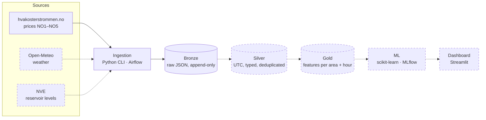

# energy-data-platform

[](https://github.com/AnSloge/energy-data-platform/actions/workflows/ci.yml)


An end-to-end data platform for the Norwegian electricity market. It ingests day-ahead prices for the five price areas (NO1–NO5), weather and hydro reservoir levels, then refines them through a Bronze → Silver → Gold lakehouse. A forecasting model trains on the Gold layer, and a dashboard serves the results.

> [!NOTE]
> **This project is a work in progress.** Price ingestion into the Bronze layer is built, tested and runs in CI. The later stages are designed but not built yet. See [Status](#status) for details.

## Architecture



Solid lines are built. Dashed lines are planned.

| Layer | Responsibility |
| --- | --- |
| **Bronze** | Every API response stored byte for byte with ingestion metadata (run ID, timestamp, source, URL, row count). Append-only, so Silver can always be rebuilt without re-downloading. |
| **Silver** | Clean tables with UTC timestamps, MWh units, explicit schemas, deduplication on `price_area + timestamp_utc`, and quality checks. Invalid rows go to quarantine. |
| **Gold** | One forecasting row per `price_area + timestamp_utc`, built only from data that was available before the 12:00 day-ahead auction cutoff, so the features don't leak future information. |
| **ML / Serving** | A naive baseline and a stronger model, evaluated with a chronological train/test split and tracked in MLflow. Predictions are written back to Gold and shown in the dashboard. |

## Tech stack

| Area | Built with | Planned |
| --- | --- | --- |
| Ingestion | Python 3.12 standard library (`urllib`, `argparse`, `zoneinfo`) | Apache Airflow for scheduling |
| Storage and transformation | Local file lake (`data/bronze/`) | Databricks Free Edition: PySpark, Delta Lake, SQL |
| Machine learning | | scikit-learn, MLflow |
| Serving | | DuckDB, Streamlit |
| Quality | pytest, ruff, GitHub Actions | Data-quality checks with a quarantine layer |

## Status

| Stage | State |
| --- | --- |
| Data source research and exploration ([notebooks](notebooks/), [findings](docs/data-sources.md)) | ✅ Done |
| Bronze writer: atomic writes, commit marker, idempotent reruns | ✅ Done |
| HTTP client with retries and backoff, price ingestion, backfill/incremental CLI | ✅ Done |
| CI: lint and tests on every push and pull request | ✅ Done |
| Bronze ingestion for weather (archive and forecast) and NVE reservoirs | 🚧 In progress |
| Airflow orchestration | Planned |
| Silver and Gold on Databricks (PySpark, Delta Lake) with data-quality checks | Planned |
| Forecasting model with MLflow tracking | Planned |
| Streamlit dashboard | Planned |
| Logging and monitoring (run status, row counts, freshness) | Planned |

## Design decisions

- **Bronze writes are crash-safe.** The data file and its `.meta.json` sidecar are each written to a temp file and then moved into place with `os.replace`. The meta file goes last and acts as the commit marker. A data file without one is treated as incomplete and is overwritten on retry. A committed file is never overwritten.
- **Reruns are free.** Ingestion checks for a commit marker before it makes a request, so a rerun or a resumed backfill makes no API calls for data it already has.
- **Network failures are handled.** Requests retry 5xx, 429, timeouts and connection errors with exponential backoff (1, 2 and 4 s). Other 4xx errors fail immediately. One failing price area or day is logged without stopping the run, and the CLI exits non-zero if anything failed.
- **Time zones are explicit.** Bronze partitions prices by Oslo delivery day and weather by UTC date, as the spec defines. Silver (planned) will convert everything to UTC. Its validation will expect 23- and 25-hour days at daylight-saving changes and will allow negative prices, which exploration showed are real.
- **Tests never hit live APIs.** Unit tests use recorded fixtures in [`tests/fixtures/`](tests/fixtures/). Tests that call live APIs carry an `integration` marker, and the default run excludes them.

The full Bronze specification, including the rules Silver relies on, is in [`specs/Bronze_ingestion.md`](specs/Bronze_ingestion.md).

## Getting started

Requires Python 3.12+.

```bash
git clone https://github.com/AnSloge/energy-data-platform.git
cd energy-data-platform
python -m venv .venv && source .venv/bin/activate
pip install -e ".[dev]"

ruff check . && pytest          # lint and the offline test suite
```

Ingest electricity prices into `data/bronze/`:

```bash
# last 7 days through tomorrow (tomorrow's prices are published around 13:00 Oslo time)
python -m energy_platform.ingestion incremental

# a specific range; leave out --start/--end to backfill from autumn 2021
python -m energy_platform.ingestion backfill --start 2026-10-01 --end 2026-10-07
```

The primary data sources need no API keys. Copy `.env.example` to `.env` only when you need the optional sources.

## Project structure

```
src/energy_platform/
  ingestion/        Bronze writer, HTTP client, per-source ingestion, CLI
  transformation/   Bronze → Silver → Gold (planned)
  quality/          data-quality checks (planned)
  ml/               forecasting model (planned)
  serving/          query layer for the dashboard (planned)
tests/              pytest suite and recorded API fixtures
notebooks/          exploration of each data source
specs/              written specification per pipeline stage
tasks/              implementation plan and task checklist for the current stage
docs/               data source catalogue and exploration findings
dags/  dashboard/   Airflow DAGs and Streamlit app (planned)
data/               local lake: bronze/ silver/ gold/ quarantine/ (contents not committed)
```

## How it's built

Each pipeline stage starts with a written spec ([`specs/`](specs/)) and is broken down into small, testable tasks ([`tasks/`](tasks/)). Each task is built test-first and merged through a pull request with CI. I use [Claude Code](https://claude.com/claude-code) as a pair programmer, and [`CLAUDE.md`](CLAUDE.md) holds the project rules it follows.

## Data sources

- Electricity prices from [hvakosterstrommen.no](https://www.hvakosterstrommen.no)
- Weather data by [Open-Meteo.com](https://open-meteo.com), licensed under [CC BY 4.0](https://creativecommons.org/licenses/by/4.0/)
- Reservoir statistics from [NVE Magasinstatistikk](https://biapi.nve.no/magasinstatistikk/swagger/index.html) (Norwegian Water Resources and Energy Directorate)

## License

This repository has no open-source license. You are welcome to read the code, but all rights are reserved.
